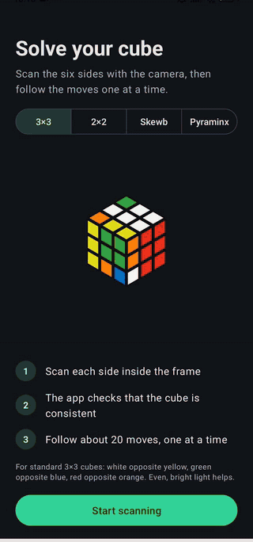
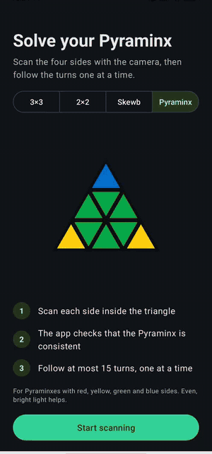
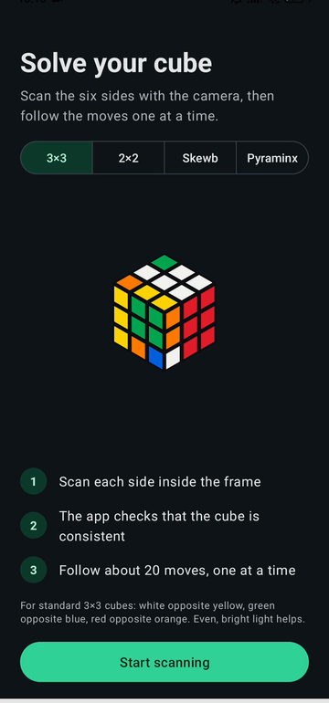
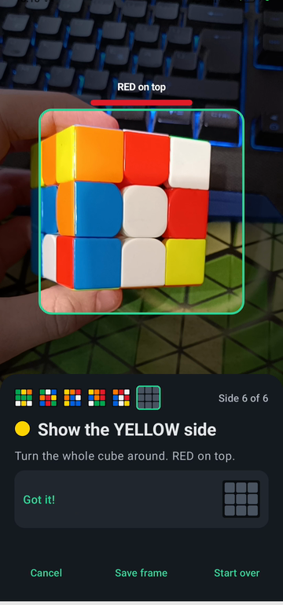
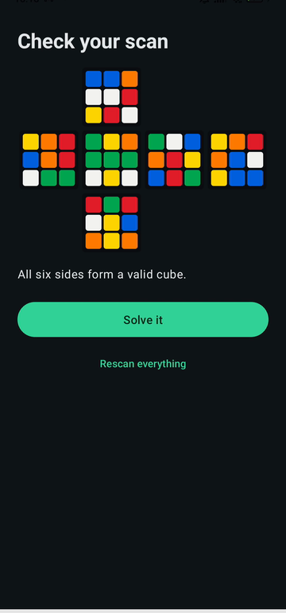
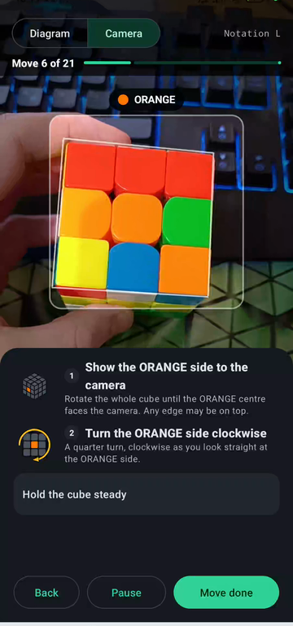
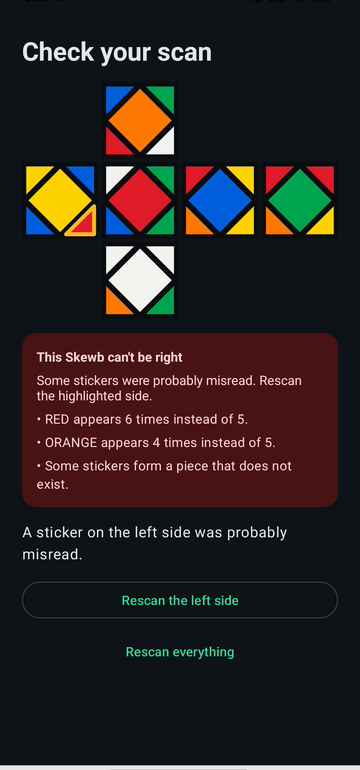
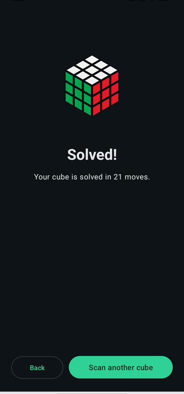

# RubikCV

An Android app that scans a twisty puzzle with the phone camera, checks that the scan is valid, solves it, and walks you through the solution move by move.

Supported puzzles: **3x3 Rubik's Cube, 2x2, Skewb and Pyraminx**.

  
  &nbsp;&nbsp;&nbsp;
  

## How it works

1. **Scan.** The app tells you which side to show and how to hold the puzzle. Each side is read from the camera frame, and unclear frames (blur, reflections, bad angle) are rejected with a short hint.
2. **Check.** The scanned sides are checked for consistency. If the puzzle can't exist (for example, a colour appears too many times), the app points to the side that was probably misread so you only rescan that one.
3. **Solve.** The 3x3 is solved with Kociemba's two-phase algorithm in about 20 moves. The Skewb and Pyraminx are solved optimally.
4. **Follow along.** Each move is shown on a diagram. For the 3x3 there is also a live camera guide that recognises the side you are holding and draws the turn arrow on it.

## Screenshots

| Home | Scanning | Scan check |
|:---:|:---:|:---:|
|  |  |  |

| Camera guide | Misread detection | Solved |
|:---:|:---:|:---:|
|  |  |  |

## Tech

- Java 17, Android (Views UI), CameraX
- Own computer vision code in plain Java, with no OpenCV and no machine learning
- Own implementation of the two-phase solver for the 3x3, plus optimal solvers for the Skewb and Pyraminx
- Separate core modules for the puzzle models, validation, solvers and vision
- Unit tests for the solvers and recognition, and UI flow tests with Robolectric